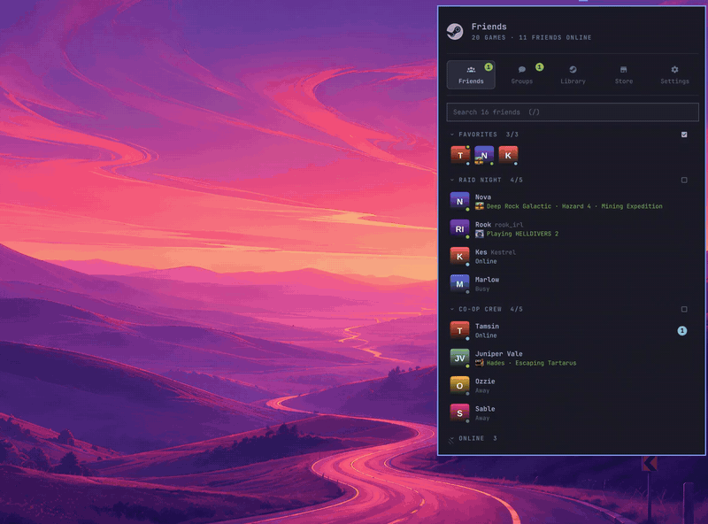

# Steam for Omarchy

A bar widget for [Omarchy](https://omarchy.org)'s shell that puts Steam in a popup:

<p align="center">
  
</p>

<sub>Recorded on the built-in [demo account](#demo-mode): the people and chats are made up.
[MP4 version](screenshots/demo.mp4).</sub>

### Friends

- Who's online, away, busy or in a game, with the game's icon and its rich presence ("Hazard 4 ·
  Mining Expedition").
- The nicknames you've given people, with their Steam name beside them (optional).
- Your Steam friend groups and Favorites as sections. Collapse any section from its header, and it
  keeps your place in the list. Hide offline friends if you like.
- Show a group as **icons**: tick the box on its header and its friends become a scrolling row of
  avatars in its place (mouse wheel, touch or drag).
- Search by name, and see unread counts.

### Chat

- Click a friend to chat beside the list. Use the window button to pop the chat out into its own
  window; clicking it again focuses that window, switching workspace if needed.
- Send with `Enter` or the send button. Messages show times inline and reactions you can add or
  take back. You can see when someone is typing.
- Shared things become cards:
  - store links and Workshop items
  - images, which open a zoom viewer (click for 10% steps, or `Shift` + wheel around the pointer)
  - Steam videos, which play inline or in a window
  - YouTube links, which play in `mpv`
  - link previews
  - any other Steam tag, shown with its fields and a button to copy the original
- Emoticons, stickers and links all render.

### Groups

- Your Steam group chats (named groups, Steam group chats and chats with several friends), newest
  first, with unread counts and `@` mentions.
- Open one to see its members as avatars (online first), read and write in it, switch between its
  rooms, or pop it out into its own window.

### Library

- Everything you own, searchable (`/`). It's laid out in three sections:
  - **Recent**: the games you played last.
  - **Remote Play**: with other computers signed in to Steam, a row per computer with how many of
    your games it can stream. Click one to Remote Play its desktop.
  - **Games**: the rest.
- Recent and Remote Play minimise like friend groups, and Remote Play can show its computers as
  icons.
- One line of chips filters every section:
  - **Installed** (on by default, and including games installed on your other computers)
  - **Uninstalled** and **Most played**
  - **Group by computer**
  - This PC, and a chip per computer, to show only that computer's games
- Click a game to play it, or to stream it from another computer (it asks first). Hover a game to
  pick another computer or install it here.
- **Panel view** shows each section as a wrapping grid of portrait covers. Click a cover for its
  options: play, stream, install, store page, open in Steam, properties, uninstall.

### Downloads

- Live progress, speed and time left, with pause and resume.
- Runtimes and redistributables count as part of the game they're for.
- Collapse the section with its header or `d`.

### Store

- The store's top 50 sellers, popular upcoming games and popular new releases.
- Click a game you don't own (or press `i` on any game) to open its store page beside the list:
  trailers and screenshots, description, reviews, tags, Steam Deck status, system requirements and
  the most helpful reviews. Buying opens Steam.

<p align="center">
  
</p>

### Everywhere

- Click the Steam logo in the header to open Steam.
- A banner says when Steam's debugging port is missing and what that limits, with a button to start
  or restart Steam.
- The last friend list is cached in SQLite and shown instantly, then updated.
- The popup and its panes can be resized (see [Resizing](#resizing)).
- The [Settings](#settings) tab holds the options.

It reads the Steam client's own files, so there's no sign-in or API key to set up.

## Install

```sh
omarchy plugin add https://github.com/BlippyOhNo/omarchy-steam.git --enable
```

Then log in to Steam (native `steam` or the Flatpak). The widget shows the account that last
logged in on the machine.

Everything it needs ships with Omarchy: Python 3, `jq`, ImageMagick (store page art is AVIF,
which Qt can't show, so it's converted) and Qt Multimedia (trailers).

### Optional: install, pause and chat from the popup

Steam has no command line for installing into a chosen folder, pausing downloads or chatting.
The widget does those through Steam's local debugging port, which is off by default. To turn it
on, create this file and restart Steam:

```sh
touch ~/.local/share/Steam/.cef-enable-remote-debugging
# Flatpak Steam: ~/.var/app/com.valvesoftware.Steam/.local/share/Steam/.cef-enable-remote-debugging
```

While it's on, **any program on your computer can control your Steam client** through
`localhost:8080`. Without it the widget still works: installs and chat open in Steam, and
pause/resume is hidden.

## Resizing

Drag a bottom corner of the popup to resize it, or its side border for the width (on the side that
can move), and the
line between the list and an open chat or store page to share the width between them. Sizes are
kept.

## Settings

The **Settings** tab (the gear at the end of the menu, or `5`) saves as you go, into this widget's
entry in `~/.config/omarchy/shell.json`:

- **Steam Web API key** (optional), with steps and a link to
  [steamcommunity.com/dev/apikey](https://steamcommunity.com/dev/apikey): your exact friend list and
  status in one request when the debugging port is off, instead of reading public profiles.
- **Steam control**: whether the debugging port is connected, and if not, what's limited and the
  command to turn it on.
- **Layout**: the menu on the left or across the top; open on the first tab (on by default).
  Drag the tabs in the menu to reorder them.
- **Library**: games in Recent, start with **Installed** ticked, and the folder to install new games
  to (text matched against your Steam library folders' paths, e.g. `GAMES` for
  `/run/media/you/GAMES/SteamLibrary`; empty uses Steam's default).
- **Friends and chat**: show offline friends, Steam names beside nicknames, the time on each
  message, and which friend groups to show as icons: in their place in the
  list, as one row of avatars with what they're playing (click to chat). The box on a group's
  header switches it too.
- **Cache**: clear what's kept in `~/.cache/blip-steam`.

## Keys

| Key | Action |
| --- | --- |
| `1`–`4` | The tabs, in the menu's order |
| `5` or `,` | Settings |
| `←` `→` | Previous/next list or tab (flip media when a store page is open) |
| `↑` `↓`, `Enter` | Move, then play / install / open |
| `i` | Store page for the selected game |
| `PgUp` `PgDn` | Scroll the store page |
| `/` | Search the library |
| `d` | Collapse or expand downloads |
| `x` `x` | Uninstall the selected game |
| `r` | Refresh |
| `Esc` | Close the store page, then the popup |

From a script or keybinding:

```sh
omarchy-shell blip.steam toggle
omarchy-shell blip.steam tab store        # store | library | friends | groups | settings
omarchy-shell blip.steam store 1091500    # open a game's store page by app id
omarchy-shell blip.steam popout 12345678  # chat with a friend (by account id) in its own window
omarchy-shell blip.steam groupchat 50739  # open a group chat (by group id)
```

## What it talks to

Local Steam files (library, playtime, friends list, downloads) and, over HTTPS, Steam's public
store and community endpoints. Store lists are cached for an hour and store pages for six hours
in `~/.cache/blip-steam`. Prices are in US dollars.

## Demo mode

The recording at the top ([GIF](screenshots/demo.gif), [MP4](screenshots/demo.mp4)) is the widget running on a made-up account. To try it:

```sh
cd ~/.config/omarchy/plugins/blip.steam
python3 -m demo on     # build the demo account and switch the widget to it
python3 -m demo off    # back to your own Steam
```

The demo has invented friends, group chats, messages and Remote Play computers, and real store
games (their art is downloaded once). It lives in `~/.cache/blip-steam-demo`. While it's on, the
helpers read the demo's Steam folder, answer store requests from the demo's own data, and send
what they'd send to Steam's debugging port to a stand-in client (`demo/fake_steam.js`, run with
Node or Bun) instead. Your Steam isn't touched. The switch is a file in `$XDG_RUNTIME_DIR`, so it
also ends when you log out.

## Tests

```sh
python3 -m unittest discover -s tests
```

These use only the standard library, plus Node or Bun for the tests of the scripts sent to Steam.
They cover the cache, Steam's file formats (text VDF, binary `appinfo.vdf`), the library,
downloads, friends, store parsing, the debug-port WebSocket, every `steamctl.py` command against
the stand-in client, and the chat's BBCode handling. They run offline on a throwaway demo account
and don't touch your Steam or the widget's cache.

## Update / remove

```sh
omarchy plugin update blip.steam
omarchy plugin remove blip.steam
```

## License

MIT, see [LICENSE](LICENSE).
